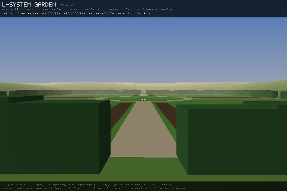
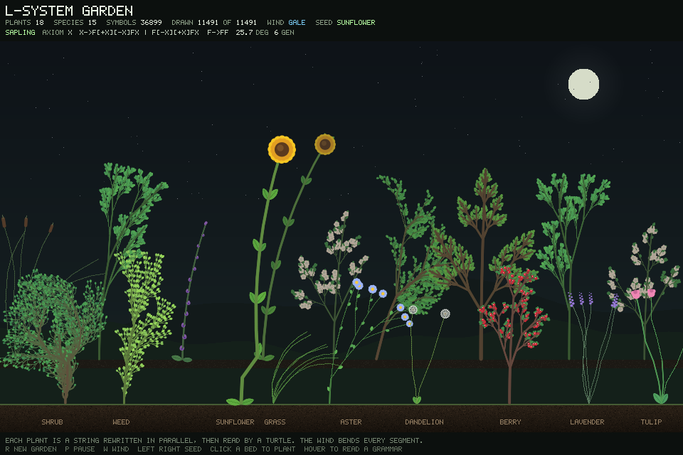
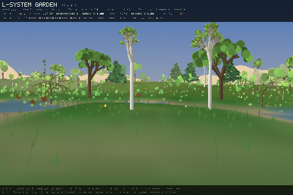

# L-System Garden

Plants grown from L-systems that live, seed and evolve on a map or a small planet. Written in Flow, running in WebAssembly.

**Try it in your browser:** [Open the live demo](https://godofecht.github.io/lsystem-garden/)



## What this is

A world of plants grown from text. Every plant is an L-system (a short starting string plus rules that rewrite each letter, applied again and again), read by a turtle (a pen that moves forward and turns as it reads each letter). Every plant is born, flowers, sets seed and dies. Seeds inherit their parent's traits with small random changes, so the plants slowly evolve as you watch.

The garden is written in [Flow](https://github.com/flooooooooooow/flow), a programming language made by the same author. Flow code is turned into C, and the C is compiled to WebAssembly (a format that lets compiled code run inside a web browser). The pictures are drawn by a software renderer, one pixel at a time, with no graphics card code.

## What you can learn from it

- Biology: natural selection. Seeds carry four genes (branch angle, leaf length, height and flower colour), each nudged by a small random amount. Taller plants shade their neighbours but make fewer seeds, so the average traits drift over the years.
- Biology: genotype and phenotype. The genes change the shape the turtle draws, so a change in the genes shows up as a different-looking plant.
- Biology: life cycles. Annuals die each autumn, perennial herbs die back in winter, and deciduous trees colour and drop their leaves.
- Geography: biomes. Height, moisture and temperature decide where each species can grow: tundra, boreal and temperate forest, grassland, wetland, scrub, desert, savanna and jungle.
- Computer Science: formal grammars and string rewriting, recursion through brackets, and 3D drawing without a graphics library.

## Run it

### In your browser

1. [Open the live demo](https://godofecht.github.io/lsystem-garden/).
2. Set the sliders under the picture if you want. Choose the world before you start, because it is grown at that size.
3. Press **Enter the garden**.

You can also add settings to the address: `?seed=4242` for a fixed world, `?size=1024` for a bigger map, and `?world=planet` to start on a planet. For example: `https://godofecht.github.io/lsystem-garden/?seed=4242&world=planet`.

The sliders on the page set the world, light, rain, wind, hour, day length and speed.

#### Controls

| Key | Does |
| --- | --- |
| W A S D | walk |
| Arrow keys, or drag the mouse | look |
| Click the picture | capture the mouse for looking (web page) |
| Shift or M | run |
| F | rise to the treetops, then above the map |
| Q E | choose a seed |
| Click the ground | plant the chosen seed |
| - and = | slow down or speed up time, x0.25 to x1024 |
| K | weather: automatic, dry, showers, rain, storm |
| J | day length |
| L | sunlight or even light |
| G | wind |
| I | species table with average traits |
| N | map or planet size: 256, 512 or 1024 m |
| 3 | walk the map |
| 4 | orbit a planet |
| 2 | the flat beds |
| Tab | switch between the flat beds and the 3D view |
| R | a new world (or new beds in the flat view) |
| P | pause |

Look at a plant to read its life, genes and grammar.

### On your own computer

**You will need:**

- A checkout of [Flow](https://github.com/flooooooooooow/flow).
- For the web build, [Emscripten](https://emscripten.org/docs/getting_started/downloads.html) (the C to WebAssembly compiler). The automated build uses version 5.0.1 on Ubuntu.
- [Python 3](https://www.python.org/downloads/) to serve the web page.

To open the garden in a native window, run this from inside your Flow checkout:

```sh
./flow gfx /path/to/lsystem-garden/lsystem_garden.flow
```

To build the web version into `docs/` and open it:

```sh
FLOW_HOME=/path/to/flow ./build_web.sh
python3 -m http.server -d docs
```

Then open `http://localhost:8000/?seed=4242` in your browser. You should see the same page as the live demo.

The native build reads these environment variables:

| Variable | Does |
| --- | --- |
| `LSYS_SEED=4242` | a fixed world |
| `LSYS_MAP=1024` | map size: 256, 512 or 1024 |
| `LSYS_PLANET=1` | start on a planet |
| `LSYS_REPORT=8` | run eight years without a window and print each species' births |
| `LSYS_PROFILE=1` | print each frame's time |

In the native window, Esc quits.

## How it works

Each species is an axiom (the starting string), a few rewrite rules, a turn angle and a number of generations. For example, one species has the rule `F->F[+F]F[-F][F]`: every `F` (draw a line) becomes a stem with side branches. The string is rewritten once. As the plant grows, the turtle reads a longer piece of it, so the plant extends in the order its grammar produced.

Nineteen species are written by hand. Each world adds a hundred more, generated from its seed: herbs, shrubs, ferns, grasses, broadleaf trees and conifers, each with its own grammar, colours, flowers and name.

The land has height, moisture and temperature. A species does well inside its range and poorly outside it. Seasons move the temperature: trees colour and drop their leaves where it gets cold, herbs die back, frost kills seedlings, and snow lies only where it is cold enough. Weather drifts from clear to storms, and a wet spell helps seeds take. Days are long in summer and short in winter, and nights are dark.

You can walk a map 256, 512 or 1024 m across, or orbit a small planet with exaggerated biomes. There is also a flat view of two beds, in the style of Flow's `lsystem_plant` example.



| File or folder | What is in it |
| --- | --- |
| `lsystem_garden.flow` | the window, keys and main loop |
| `garden/species.flow` | the hand-written grammars and their parameters |
| `garden/genus.flow` | the hundred species generated per world |
| `garden/derive.flow` | parallel rewriting |
| `garden/models.flow` | the 3D turtle and the model cache |
| `garden/life.flow` | birth, growth, seeds, inheritance, selection and death |
| `garden/terrain.flow` | height, moisture, temperature and biomes |
| `garden/calendar.flow` | days, seasons and time speed |
| `garden/sky.flow` | the hour, the sun and the weather |
| `garden/view.flow` | drawing the world |
| `garden/walk.flow` | walking, picking and the HUD |
| `garden/orbit.flow` | the planet |
| `garden/flat.flow` | the flat beds |
| `garden/control.flow` | what the web page can set |
| `web_src/index.html` | the web page |

## Ideas to try

1. In `garden/species.flow`, find `species_rules` and change one rule, such as `F->F[+F]F[-F][F]`. Rebuild and see how the plant's shape changes.
2. In `garden/life.flow`, the lines that make a seed's genes use `exp(0.07 * rng_gauss())` and `exp(0.08 * rng_gauss())`. Make the numbers bigger for faster mutation, then use `LSYS_REPORT=8` to compare how the species do.
3. In `garden/calendar.flow`, add a new time speed to `time_scale` and `time_scale_name`.
4. In `garden/terrain.flow`, change how temperature falls with height and watch which biomes grow or shrink.
5. Add a new hand-written species in `garden/species.flow`, with its own axiom, rules and angle.

## Technical details

### Bracket alphabet

The turtle reads these symbols, as listed at the top of `lsystem_garden.flow`:

| Symbol | Meaning |
| --- | --- |
| `F` | draw a segment forward |
| `+ -` | turn by the species angle, with a small jitter |
| `& ^` | pitch down and up (3D) |
| `/ \` | roll (3D) |
| `[ ]` | push and pop the turtle state; a closing bracket is a tip |
| `!` | thin the branches that follow |
| `L` | a leaf |
| `K` | a flower on the stem |
| `A` | an apex; what is left after the last generation blooms |
| `X B C S` | growth symbols that are rewritten and never drawn |

Several productions for one symbol make a grammar stochastic, so two plants of one species are never the same. The 15 planar grammars are lifted into 3D by rolling the turtle 137.5 degrees at every branch, the divergence angle of phyllotaxis. The last four hand-written species are trees written for a 3D turtle.

### Life model

A year is 96 days. Plants pass through seed, grow, adult, wither and dead stages. Each 6 m cell holds at most six herbs and shrubs. Shade from taller neighbours slows growth and cuts seed output; seed output also falls as the height gene rises. Nothing grows below freezing, frost below -2 kills the young of warm-climate species, and annuals die at the first frost. A few seeds of random species drift in from beyond the map each day, so a species that dies out can return. The full description is at the top of `garden/life.flow`.

### Atlas foliage (Quixel / Fab)

The web garden can render alpha-cutout textured leaves using the existing Flow software depth buffer. The L-system still generates branches, node positions, leaf orientations, growth stages and wind deformation; the atlas only supplies the photographic appearance of each leaf or frond. Ferns are identified among the nineteen authored and the generated species. The rendered cutouts use perspective-correct UVs, depth testing, sunlight, fog and seasonal tint. Tiny and distant leaves keep the cheap procedural strokes.

Open **Foliage atlas** beneath the canvas. Download a licensed atlas such as [Holly Fern on Fab](https://www.fab.com/listings/9a642c7e-ceac-48f5-bb03-5c61ebd8b0ad), choose its albedo or basecolour image, and optionally choose its matching opacity map. Drag a rectangle around one frond in the preview, keeping its base at the bottom, then press **Apply selected cutout**. Choose **Ferns** or **All leafy plants**, or turn atlas rendering off without changing the world. The import stays in browser memory; reload to discard it. This also works with user-owned non-Quixel RGBA atlases.

This panel is in `web_src/index.html`, and the live demo includes it.

No Megascans texture is committed to this repository. Obtain each file under its own terms. The [Fab Standard License](https://www.fab.com/eula) permits incorporating assets into commercial projects and non-Unreal applications but prohibits redistributing source assets on a standalone basis. Legacy Quixel or Unreal-only acquisitions may have different restrictions.

### Web build

`build_web.sh` runs `flow wasm` on `lsystem_garden.flow`, exports `_garden_set`, `_garden_get`, `_garden_atlas_upload` and `_garden_atlas_mode` for the page to call, then copies `web_src/index.html` over the generated page. On every push to `main`, the GitHub Actions workflow runs the same build and publishes the result to GitHub Pages.



## Project status

The GitHub Actions workflow `.github/workflows/build-web.yml` builds the WebAssembly version on every push and pull request. On a push to `main` it also deploys the build to GitHub Pages, so the live demo follows `main`. The `docs/` folder in the repository is an older build. Run `build_web.sh` to refresh it before serving it locally.

## Licence

You can use, copy and change this code for any purpose, as long as you keep the copyright notice. See [LICENSE](LICENSE) (MIT).

Building from source needs the Flow toolchain, which has its own licence.

## Credits

- Written by Abhishek Shivakumar in [Flow](https://github.com/flooooooooooow/flow).
- The L-system model follows Lindenmayer (1968) and Prusinkiewicz and Lindenmayer, "The Algorithmic Beauty of Plants" (1990).
- The flat beds follow Flow's `examples/morphogenesis/lsystem_plant.flow`.
- Web build by [Emscripten](https://emscripten.org/).
