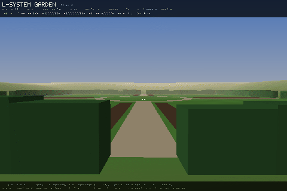
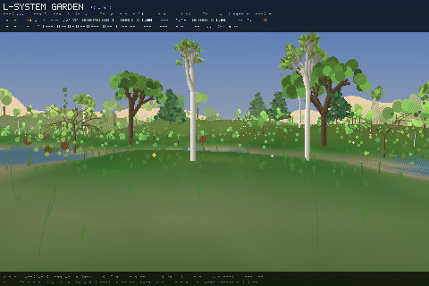
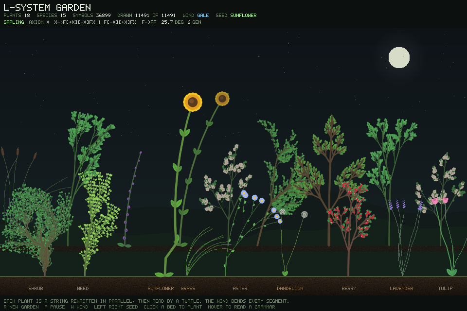

# L-System Garden

A world of plants grown from text. Every plant is an L-system, read by a
turtle, and every plant is born, flowers, sets seed and dies.

**Play it:** https://godofecht.github.io/lsystem-garden/

Written in [Flow](https://github.com/flooooooooooow/flow), compiled through C
to WebAssembly, and drawn by a software renderer one pixel at a time.





## What happens in it

Each species is an axiom, a few rewrite rules, a turn angle and a number of
generations. Nineteen are written by hand. Each world adds a hundred more,
generated from its seed: herbs, shrubs, ferns, grasses, broadleaf trees and
conifers, each with its own grammar, colours, flowers and name.

A plant grows by reading more of its own string. It flowers in its season,
sets seed and dies. Its seeds carry its branch angle, leaf length, height and
flower colour, each nudged a little, and land where the species can live.
Taller plants shade their neighbours but make fewer seeds, so the average
traits drift over the years.

The land has height, moisture and temperature, which name its biomes: tundra,
boreal and temperate forest, grassland, wetland, scrub, desert, savanna and
jungle. A species does well inside its range and poorly outside it. Seasons
move the temperature: trees colour and drop their leaves where it gets cold,
herbs die back, frost kills seedlings, and snow lies only where it is cold
enough. Weather drifts from clear to storms, and a wet spell helps seeds take.
Days are long in summer and short in winter, and nights are dark.

You can walk a map 256, 512 or 1024 m across, or orbit a small planet with
exaggerated biomes. There is also a flat view of two beds, in the style of
Flow's `lsystem_plant` example.



## Controls

| Key | Does |
| --- | --- |
| W A S D | walk |
| Arrows, drag, or click to capture the mouse | look |
| Shift or M | run |
| F | rise to the treetops, then above the map |
| Click | plant the chosen seed |
| Q E | choose the seed |
| - = | time speed, x0.25 to x1024 |
| K | weather |
| J | day length |
| L | sunlight or even light |
| G | wind |
| I | species table with average traits |
| N | map or planet size |
| 3 4 2 | walk the map, orbit a planet, the flat beds |
| R | a new world |
| P | pause |

On the web page the sliders set the world, light, rain, wind, hour, day length
and speed. Choose the world before pressing Enter and it is grown at that size.
`?seed=4242`, `?size=1024` and `?world=planet` work in the address.

## Building

You need a checkout of [Flow](https://github.com/flooooooooooow/flow) and,
for the web build, Emscripten.

```sh
# Native window, from the Flow checkout
./flow gfx /path/to/lsystem-garden/lsystem_garden.flow

# The web build, into docs/
FLOW_HOME=/path/to/flow ./build_web.sh
python3 -m http.server -d docs
```

Environment variables for the native build:

| Variable | Does |
| --- | --- |
| `LSYS_SEED=4242` | a fixed world |
| `LSYS_MAP=1024` | map size: 256, 512 or 1024 |
| `LSYS_PLANET=1` | start on a planet |
| `LSYS_REPORT=8` | run eight years without a window and print each species' births |
| `LSYS_PROFILE=1` | print each frame's time |

## Layout

| File | Holds |
| --- | --- |
| `lsystem_garden.flow` | the window, keys and main loop |
| `garden/species.flow` | the hand-written grammars and their parameters |
| `garden/genus.flow` | the hundred species generated per world |
| `garden/derive.flow` | parallel rewriting |
| `garden/models.flow` | the 3D turtle and the model cache |
| `garden/life.flow` | birth, growth, seeds, inheritance, selection and death |
| `garden/terrain.flow` | height, moisture, temperature and biomes |
| `garden/calendar.flow` | days, seasons and time speed |
| `garden/sky.flow` | the hour, the sun and the weather |
| `garden/view.flow` | drawing the world |
| `garden/walk.flow` | walking, picking and the HUD |
| `garden/orbit.flow` | the planet |
| `garden/flat.flow` | the flat beds |
| `garden/control.flow` | what the web page can set |
| `web_src/index.html` | the web page |

## Licence

Copyright 2026 Abhishek Shivakumar. All rights reserved. See `LICENSE`.
